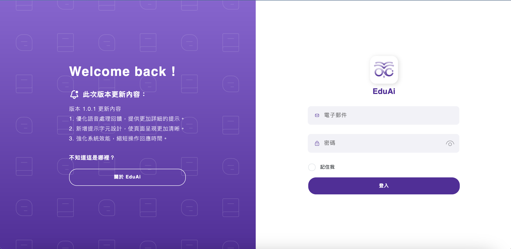

# EduAi

EduAi is a web application built around a Moodle backend. It gives students a
simpler interface for course discussions and LLM-assisted conversations, while
teachers can manage classes, upload teaching plans, and review learning
feedback. The project originated in the 2024 NTNU Software Engineering course.

> [!NOTE]
> EduAi is an educational and research project. Review the example credentials,
> API access, privacy requirements, and network exposure before deploying it
> outside a local development environment.

## Features

- Real-time student discussions with speech-to-text and LLM analysis
- Course-aware conversations with an LLM assistant
- Class, group, question, and user management through Moodle
- Teaching-plan upload and feedback
- Student learning and discussion analysis



## Architecture

The repository contains these project services:

| Service | Implementation | Default local URL |
| --- | --- | --- |
| Web application | Node.js and Express | <http://localhost:3000> |
| Reverse proxy | Nginx | <http://localhost:8088> |
| Learning platform | Moodle and Apache | <http://localhost:8080/moodle> |
| Speech-to-text API | Python and Flask | <http://localhost:5001> |
| Database administration | phpMyAdmin | <http://localhost:8081> |

The `moodle-backend/` directory is a vendored Moodle distribution. Project-
specific application work normally belongs in `frontend/`, `flask_server/`,
the Compose configuration, or project documentation.

## Getting started

### Prerequisites

- Git
- Docker with Docker Compose v2
- A Groq API key for LLM-backed features

### Run the stack

```sh
git clone https://github.com/NTNU-SoftwareEngineering/EduAi.git
cd EduAi
cp .env.example .env
```

Set `GROQ_API_KEY` in `.env`, then start the services:

```sh
docker compose up -d --build
```

Open <http://localhost:3000>. Moodle administration is available at
<http://localhost:8080/moodle>.

To inspect startup problems:

```sh
docker compose ps
docker compose logs --tail=100
```

Stop the stack without deleting database volumes:

```sh
docker compose down
```

## Local checks

Run the same lightweight checks used by continuous integration:

```sh
npm ci --prefix frontend
npm run check --prefix frontend
python3 -m compileall -q flask_server
cp .env.example .env
docker compose config --quiet
```

## Contributing and security

Contributions are welcome. Read [CONTRIBUTING.md](CONTRIBUTING.md) before
opening a pull request. Automated dependency update proposals are configured
through Dependabot. Please report vulnerabilities through the process in
[SECURITY.md](SECURITY.md), not through a public issue.

## License

EduAi is licensed under the [GNU General Public License v3.0](LICENSE).
